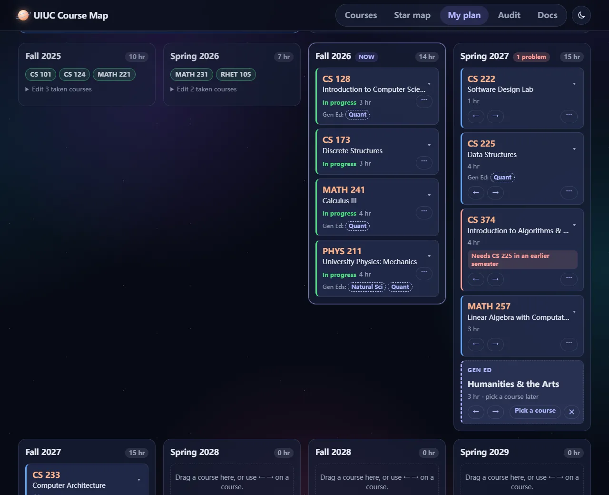

# UIUC Course Map

**Live site: https://terryduan-chn.github.io/uiuc-course-map/**

Every UIUC course, what it needs and what it leads to, and a semester-by-semester plan for your
degree. All course data comes from UIUC's official [Course Explorer](https://courses.illinois.edu/);
nothing is typed in by hand.



## What you can do

- **Find a course** by code or title, and see its official description, prerequisites, average GPA
  and the semesters it runs.
- **Find Gen Eds**: pick one or more requirements and get the courses that meet all of them, best
  average GPA first.
- **Explore the star map**: every prerequisite link at UIUC as a 3D galaxy of 4,600 courses.
- **Mark your courses** as taken, in progress or planned.
- **Plan your degree**: lay courses out by semester, drag them around, and see problems like a
  prerequisite in the wrong semester.
- **Upload your degree audit** (the uAchieve PDF) to see what's left, and let **Auto-plan** fill the
  remaining semesters, leaving Gen Eds as slots for you to pick.

The [Docs page](https://terryduan-chn.github.io/uiuc-course-map/#docs) explains every feature, how
the data and Auto-plan work, and common questions.

## Privacy

There is no account and no server. Your plan is saved only in your own browser. An uploaded audit is
read in your browser and never sent anywhere; only requirements and course codes are kept, never your
name or ID.

## How it's built

A static website: HTML, CSS and JavaScript, with no build step. The course data is a SQLite database
that the page queries in the browser with [sql.js](https://sql.js.org/); the star map is drawn with
[three.js](https://threejs.org/), and audits are read with [pdf.js](https://mozilla.github.io/pdf.js/).

```
index.html   the page
css/         styles: the whole site, your plan and audit, the docs
js/          the app, one file per page or job (app.js starts it)
data/        courses.db, every course, prerequisite, Gen Ed and GPA
docs/        the Docs page's text and pictures
```

Data sources:

- **Courses, prerequisites, Gen Eds, terms offered:** UIUC Course Explorer.
- **Average GPA:** Wade Fagen-Ulmschneider's
  [GPA dataset](https://github.com/wadefagen/datasets/tree/main/gpa).

## Run it yourself

Any static file server works; browsers won't load the database from `file://`. For example:

```bash
npx http-server . -p 8080
```

Then open http://localhost:8080.

## About

Built by Zongyan (terryduan-chn) as a CS 124 independent project at the University of Illinois.
Unofficial: always check your plan with your advisor and the official degree audit.
